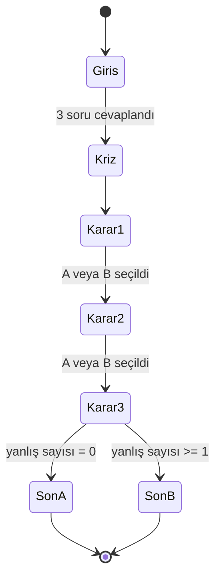

# spec.md — SE Primer: "08:00, Randevu Sistemi Çöktü"

## 1. Problem

Yazılım mühendisliği öğrencileri mimari, test ve KVKK gibi konuları ayrı ayrı öğreniyor ama bir kriz anında bu kararları **birlikte** ve **baskı altında** vermeyi hiç denemiyor. Slayt ve ders notları "ne yapılmalı" der; "yanlış yapınca ne olur" göstermez.

**Çözüm:** Telefonda oynanan seçimli bir hikâye. Oyuncu bir hastane bilgi işlem nöbetçisidir. Her seçim bir mühendislik kararıdır, uygulama kararın sonucunu ve nedenini gösterir. Bir AI tutor takılan oyuncuya cevabı söylemeden soru sorarak yardım eder.

**Hedef kullanıcı:** Yazılım mühendisliği dersini alan 3. sınıf öğrencisi.

## 2. Senaryo

> "08:00, randevu sistemi çöktü. Nöbetçi sensin."
> Dün gece yeni sürüm çıktı. 300 hasta bekliyor. (Kurgusal hastane, sentetik hasta isimleri.)

| Karar | Konu | Seçenek A (doğru) | Seçenek B (riskli) |
|---|---|---|---|
| 1 | Mimari | Eski sürüme geri dön | Canlıda yama yap |
| 2 | Test | Önce kısa test koş | Hemen yayına al |
| 3 | KVKK | Logdaki hasta adını maskele | Logu ekibe olduğu gibi at |

**Son kuralı:** Yanlış seçim oyunu erken bitirmez, sonuç gösterilir ve oyun devam eder. Üç karardan sonra:

- **Son A (İyi):** 0 yanlış seçim. "08:25, sistem ayakta, veri güvende."
- **Son B (Kötü):** 1 veya daha fazla yanlış seçim. "Sistem ayakta ama KVKK ihlali / kesinti riski." Son ekranı hangi kararın neden hatalı olduğunu listeler.

## 3. Kapsam

**Yapılacak**

- Telefonda açılan web uygulaması (AI Studio linki)
- Girişte 3 soru: seviye, rol, hedef. Anlatı buna uyar
- 1 sağlık senaryosu, 3 karar, 2 farklı son
- Her seçimden sonra: ne oldu, neden oldu
- AI tutor: ipucu verir, cevabı vermez

**Kişiselleştirme kuralları**

- Seviye "Yeni başladım": her kararda ipucu butonu görünür
- Seviye "Deneyimliyim": her karar için 60 saniyelik süre. Süre dolarsa karar hatalı sayılır
- Rol ve hedef: sahne metnindeki dil ve vurgu değişir (ör. rol "geliştirici" ise teknik terimler açık, "yönetici" ise sade)

## 4. Kapsam dışı

- Kullanıcı hesabı, giriş
- İkinci bölüm
- Gerçek hasta verisi (yalnızca kurgusal hastane ve sentetik isimler)
- Native mobil uygulama

## 5. Akış (durum makinesi)

Her `Karar` durumundan sonra bir **Sonuç** ekranı (ne oldu, neden oldu) gösterilir, "Devam" ile bir sonraki karara geçilir. Durumlar: Giris, Kriz, Karar1, Karar2, Karar3, SonA, SonB.

## 6. Kabul örnekleri

**KÖ-1: Giriş zorunlu**
- Verilen: Oyuncu giriş ekranında
- Eğer: 3 sorudan biri boşken "Başla"ya dokunur
- O zaman: Oyun başlamaz, eksik soru işaretlenir

**KÖ-2: Kişiselleştirme**
- Verilen: Seviye "Yeni başladım" seçilmiş
- Eğer: Karar ekranı açılır
- O zaman: İpucu butonu görünür ve zamanlayıcı yoktur
- Verilen: Seviye "Deneyimliyim" seçilmiş
- Eğer: Karar ekranı açılır
- O zaman: 60 sn geri sayım görünür, süre dolunca karar hatalı sayılıp sonuç ekranına geçilir

**KÖ-3: İyi son**
- Verilen: Oyuncu Karar 1, 2, 3'te sırasıyla A seçer
- O zaman: Son A ekranı ("08:25, sistem ayakta, veri güvende") görünür

**KÖ-4: Kötü son ve açıklama**
- Verilen: Oyuncu en az bir kararda B seçer
- O zaman: Her seçimden sonra "ne oldu, neden oldu" gösterilir ve oyun sonunda Son B ekranı hatalı kararları gerekçeleriyle listeler

**KÖ-5: Tutor cevabı vermez**
- Verilen: Oyuncu tutor'a "cevabı söyle" diye ısrar eder
- O zaman: Tutor doğru seçeneği söylemez, yönlendirici bir soru sorar (ör. "Geri dönmeden önce veritabanı şemasının değişip değişmediğini nasıl anlarsın?")

## 7. Tutor davranış kuralları

1. Hangi seçeneğin doğru olduğunu **asla** söylemez ("A'yı seç" yok).
2. Her yanıtta en fazla bir yönlendirici soru sorar.
3. Oyuncu ısrar etse de aynı kuralı korur, kibarca kavramı hatırlatır.
4. Hasta verisi veya gerçek kişi bilgisi istemez.

## 8. Görünmez varsayımlar (arkadaş testinden sonra güncellenecek)

- Oyuncu "geri dön" ifadesinin sürüm geri alma (rollback) olduğunu biliyor varsayılıyor.
- Oyuncu "maskelemek" kelimesini biliyor varsayılıyor.

> Arkadaşına oynattığında ilk takıldığı yeri buraya ekle ve yeni bir kabul örneğine çevir.